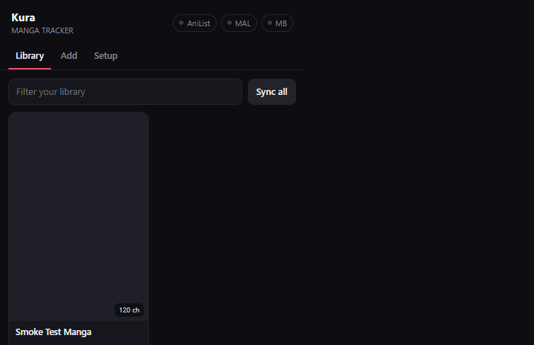

# Kura — manga-first, three trackers at once

<p>
  <a href="LICENSE"></a>
  
  <a href="manifest.json"></a>
  
</p>

A browser extension that treats your trackers as **mirrors, not as the place you work**. Read a
chapter anywhere, mark it once, and **MyAnimeList, AniList and MangaBaka** all move together —
each with its own status, so you can see exactly which one is behind.

MAL-Sync does this for anime, with one tracker at a time. Kura is built around manga and around
having more than one tracker.



## The two ideas

**1. Multi-tracker by default.** Most tools ask you to pick a service. Kura connects all of them:
every progress change fans out in parallel, and a tracker that fails does not block the others —
it is marked `error` with the reason and retried in the background.

**2. Highest chapter wins.** Reading is monotonic, so the furthest progress is the safest truth.
On sync Kura pulls every linked tracker, adopts the highest chapter, and pushes it to the rest.
Read on MyAnimeList's own site on your phone and it lands on AniList and MangaBaka next time.

```
            ┌────────────┐
  +1 ──────▶│  library   │  canonical: chapters, status, rating
            └─────┬──────┘
        ┌─────────┼─────────┐
        ▼         ▼         ▼
   MyAnimeList  AniList  MangaBaka      each with its own synced / pending / error state
```

## Install (unpacked, today)

```bash
git clone https://github.com/Huzbi-crypto/kura.git
```

1. `chrome://extensions` → **Developer mode** → **Load unpacked** → the cloned folder.
2. Open the popup → **Setup**. Three clicks:
   - **AniList** → Connect.
   - **MyAnimeList** → Connect.
   - **MangaBaka** → paste a personal access token from mangabaka.org → Save.

The AniList client id and the MyAnimeList token-exchange Worker ship with Kura, so there is nothing
to register: the Worker exists because MAL's token endpoint needs a client secret, and a secret must
not live in a bundle. The Worker is the maintainer's deployment and can be replaced in Setup, along
with the client id:

```bash
cd worker && npx wrangler deploy
npx wrangler secret put MAL_CLIENT_ID
npx wrangler secret put MAL_CLIENT_SECRET
```

## Using it

- **Library** — cover grid, chapters read against total, progress bar, one-tap `+1`, per-tracker
  dots (green synced, amber pending, red error), filter, **Sync all**.
- **Reading pill** — on atsu.moe, stonescape.xyz, weebcentral.com and mangadot.net a small pill
  shows the series and chapter with `+1`. If a page can't be parsed it asks for the number once
  rather than silently doing nothing.
- **Add** — search MangaBaka; the MAL and AniList ids resolve automatically through the bridge.

## Privacy

No account, no analytics, no telemetry, no remote code. Tracker tokens live in your browser's
extension storage, and Kura talks to the services you connect — plus one Worker for MyAnimeList's
token exchange, which forwards the request with the client secret attached and stores nothing.
Full policy: [docs/PRIVACY.md](docs/PRIVACY.md).

## Develop

No build step, no dependencies. ES modules straight into MV3.

```bash
KURA_BROWSER_TESTS=1 node tools/verify-extension.mjs   # headless load, worker, popup, add + bump
node tools/package.mjs                                # dist/kura-<version>.zip for the Web Store
```

The `KURA_BROWSER_TESTS=1` gate is deliberate: those harnesses launch a headless browser, and the
gate keeps a plain `node tools/*.mjs` from doing it by accident.

Architecture and the reasoning behind the sync rules: [ARCHITECTURE.md](ARCHITECTURE.md).
Store submission copy and permission justifications: [docs/STORE-LISTING.md](docs/STORE-LISTING.md).

```
src/sync.js            pull → highest chapter wins → push fan-out, retry queue
src/mapping.js         cross-tracker ids via MangaBaka
src/trackers/*.js      one adapter per service (pull / push / search)
src/sites/*.js         per-site rules: url patterns, title and chapter extractors, panel placement
src/db.js              IndexedDB: series, state, queue, kv
src/content/overlay.js reader pill (shadow DOM, SPA-aware)
worker/mal-token.js    MAL token exchange (Cloudflare Worker)
```

## Roadmap

- [x] First-run import: pull an existing list from a tracker into the library.
- [x] Reader detectors for atsu.moe, stonescape.xyz, mangadot.net and weebcentral.com, audited
  against the live pages (`docs/SITES.md`).
- [ ] Ratings and notes surfaced in the UI.
- [ ] Divergence view: "MAL says 42, AniList 40 — make them agree" in one tap.
- [ ] More readers, more trackers (Kitsu, Shikimori — MangaBaka already bridges their ids).

## License

MIT — see [LICENSE](LICENSE). Not affiliated with MyAnimeList, AniList, MangaBaka or MAL-Sync.
